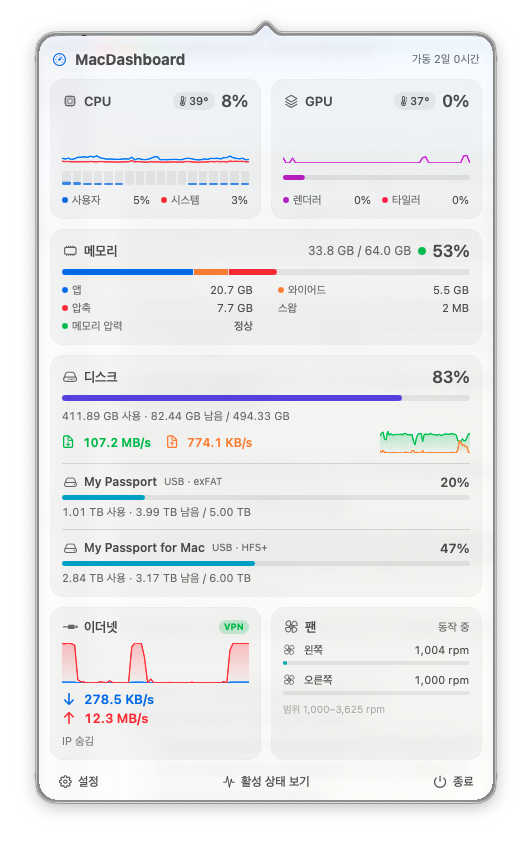
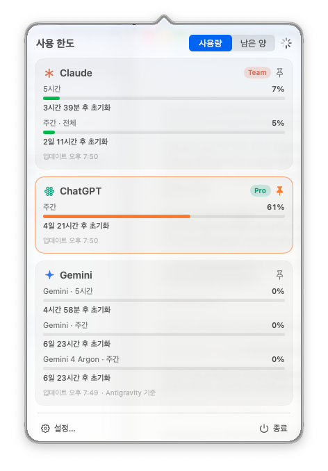

# MacDashboard

메뉴 막대에서 시스템 상태와 AI 사용 한도를 한 번에 보는 macOS 앱 (Swift / SwiftUI, macOS 26+).

- **시스템 팝오버**: CPU(사용자/시스템, 코어별, 온도), GPU(렌더러/타일러, 온도), 메모리(앱/와이어드/압축/스왑, 메모리 압력), 디스크(용량, 읽기/쓰기 속도), 네트워크(속도, IP, VPN 여부), 팬 rpm
- **사용 한도 팝오버**: Claude, ChatGPT(Codex), Gemini(Antigravity)의 5시간/주간 사용률과 초기화까지 남은 시간
- 메뉴 막대 항목, 배지에 고정할 서비스, 사용량/남은 양 표시, 갱신 주기, IP·계정 이메일 표시, 로그인 시 자동 실행은 설정에서 바꿀 수 있어요.

## 스크린샷

메뉴 막대 — 왼쪽 배지는 고정한 서비스의 사용량, 오른쪽은 CPU · 온도 · 메모리 · SSD · 네트워크 속도


| 시스템 대시보드 | 사용 한도 |
|---|---|
|  |  |

스크린샷은 설정에서 IP 주소와 계정 이메일 표시를 끈 상태예요.

## 설치 (Release)

1. [Releases](https://github.com/ksemperor97/MacDashboard/releases)에서 `MacDashboard-<버전>.zip`을 받아 압축을 풀고 `MacDashboard.app`을 `/Applications`로 옮겨요.
2. 이 앱은 Apple 공증을 받지 않은 ad-hoc 서명이라 처음 열 때 macOS가 막아요. 한 번 열기를 시도한 뒤 **시스템 설정 → 개인정보 보호 및 보안 → "그래도 열기"**를 누르세요. 터미널에서는 이 명령으로도 돼요.
   ```bash
   xattr -dr com.apple.quarantine /Applications/MacDashboard.app
   ```

요구 사항: Apple Silicon Mac, macOS 26 (Tahoe) 이상. AI 사용량은 그 Mac에서 로그인된 Claude Code / Codex / Antigravity CLI 계정 기준이에요.

## 빌드와 설치

```bash
scripts/build_app.sh            # build/MacDashboard.app 생성
scripts/build_app.sh --install  # /Applications 에 설치
scripts/build_app.sh --zip      # 릴리스용 zip 생성
```

Xcode 없이 Command Line Tools(Swift 6.4)만으로 빌드돼요. 서명은 ad-hoc이에요.

## 데이터 출처

| 항목 | 출처 |
|---|---|
| CPU / 메모리 | Mach `host_processor_info`, `host_statistics64`, `sysctl` (`kern.memorystatus_vm_pressure_level`) |
| 디스크 | `volumeAvailableCapacityForImportantUsage` (Finder와 같은 값), IOBlockStorageDriver 통계 |
| 외장 디스크 | DiskArbitration으로 외장 물리 디스크만 고르고 `statfs`로 용량을 읽어요. 네트워크·FUSE 마운트는 제외해요. 30초마다, 그리고 연결/해제 알림이 올 때 다시 확인해요 |
| 네트워크 | `NET_RT_IFLIST2` 64비트 카운터, SystemConfiguration. VPN을 쓸 때는 실제로 트래픽이 지나가는 물리 인터페이스를 보여줘요 |
| GPU | IOAccelerator `PerformanceStatistics` |
| 온도 / 팬 | AppleSMC (`Tp*`, `Tg*`, `F*Ac`), IOHIDEventSystem (root 권한 불필요) |
| Claude | Claude Code가 키체인에 저장한 OAuth 토큰 → `api.anthropic.com/api/oauth/usage` |
| ChatGPT | `~/.codex/auth.json` → `chatgpt.com/backend-api/wham/usage`. 실패하면 `~/.codex/sessions`의 마지막 기록을 써요 |
| Gemini | `agy -p /quota --output-format json` (Antigravity CLI. 쿼터를 소모하지 않음) |

AI 사용량 API는 공식 문서가 없는 내부 엔드포인트라 바뀔 수 있어요. 토큰은 읽기만 하고, 직접 갱신하거나 다른 곳에 저장하지 않아요.

## 진단용 실행 옵션

```bash
build/MacDashboard.app/Contents/MacOS/MacDashboard --dump-system     # 시스템 수치 3회 출력
build/MacDashboard.app/Contents/MacOS/MacDashboard --dump-usage      # AI 사용량 조회 결과 출력
build/MacDashboard.app/Contents/MacOS/MacDashboard --probe-sensors   # SMC/HID 온도·팬 센서 목록
open build/MacDashboard.app --args --open system|usage|settings     # 실행 직후 해당 창 열기
```
